# Toward Intelligent Lightweight and Efficient UAV Identification With RF Fingerprinting

PyTorch implementation accompanying the paper:

> **Toward Intelligent Lightweight and Efficient UAV Identification With RF Fingerprinting**  
> Zhenxin Cai, Yu Wang, Qi Jiang, Guan Gui, and Jin Sha  
> *IEEE Internet of Things Journal*, vol. 11, no. 15, pp. 26329–26339, Aug. 2024.  
> DOI: [10.1109/JIOT.2024.3395466](https://doi.org/10.1109/JIOT.2024.3395466)

[](https://doi.org/10.1109/JIOT.2024.3395466)
[](https://www.python.org/)
[](https://pytorch.org/)

---

## Overview

Radio-frequency fingerprint identification (RFFI) identifies individual wireless transmitters from device-specific hardware imperfections embedded in their emitted RF signals. For UAV monitoring, deep-learning-based RFFI can provide passive and non-cooperative device authentication, but many existing models require substantial computation and storage, which limits deployment on resource-constrained platforms.

This work proposes a **lightweight UAV RFFI framework** centered on a **Lightweight Multiscale Convolution (LMSC) block**. The LMSC block combines hierarchical multiscale feature extraction with depthwise separable convolution, enabling the network to capture informative time–frequency patterns while substantially reducing computational cost. The framework further uses **sample truncation** to reduce input length and **Mixup regularization** to improve generalization without increasing model parameters or MACs.

The task considered in the paper is **individual identification of seven identical UAVs**, rather than UAV model or flight-mode classification.

---

## Highlights

- **Lightweight multiscale backbone.** Four stacked LMSC blocks extract multiscale RF fingerprint features with low computational overhead.
- **Noise-robust UAV identification.** The proposed model performs strongly over test SNRs from −5 dB to 20 dB and achieves 98.59% accuracy at 8 dB.
- **Efficient data truncation.** A sample length of 2000 retains competitive identification performance while reducing both MACs and parameters by approximately 92.63% relative to the full-length setting.
- **Zero-complexity Mixup improvement.** Mixup increases the reported average accuracy from 93.25% to 93.92% without adding model parameters, storage, or MACs.
- **Interpretable feature learning.** LayerCAM visualizations show that the proposed network focuses on informative spectrogram regions and is less distracted by background noise.

---

## Method

### Overall Pipeline

```mermaid
flowchart LR
    A[Raw complex I/Q samples] --> B[Min-max normalization]
    B --> C[AWGN augmentation]
    C --> D[STFT]
    D --> E[Log-power spectrogram]
    E --> F[Frequency-axis segmentation]
    F --> G[7 x 7 Conv, 32 channels + ReLU]
    G --> H[Four stacked LMSC blocks]
    H --> I[Average pooling]
    I --> J[Linear layer + Softmax]
    J --> K[UAV identity]
```



Mixup is enabled only during training and linearly combines two training samples and their corresponding one-hot labels.

### Data Preprocessing

The paper uses the following preprocessing procedure:

1. Apply min-max normalization to the input RF samples.
2. Add additive white Gaussian noise (AWGN).
3. Convert the nonstationary raw I/Q signal into a time–frequency representation using the short-time Fourier transform (STFT).
4. Construct a logarithmic power spectrogram:

   $$
   S(m,k)=\log_{10}\left(|\mathrm{STFT}(m,k)|^2\right).
   $$

5. Crop the spectrogram along the frequency axis to suppress out-of-band interference and retain the informative signal region.

During training, the SNR is randomly sampled from **0–10 dB**. During testing, fixed SNR levels within **−5–20 dB** are evaluated.

> **Reproducibility note:** the paper specifies a Hamming window and frequency-axis spectrogram segmentation, but it does not report the exact numerical STFT window length, overlap, or crop boundaries. Use the released preprocessing code as the source of truth for these settings.

### Lightweight Multiscale Convolution Block

For an input feature map $F$, the LMSC block splits the channels into $s$ subsets:

$$
F_i \in \{F_1,F_2,\ldots,F_s\}.
$$

The hierarchical branch outputs are

$$
y_i=
\begin{cases}
F_i, & i=1,\\
H_{\mathrm{DSC}}(F_i), & i=2,\\
H_{\mathrm{DSC}}(F_i+y_{i-1}), & 2<i\le s,
\end{cases}
$$

where $H_{\mathrm{DSC}}(\cdot)$ denotes a depthwise separable convolution unit. All branch outputs are concatenated to form the multiscale representation.

Each depthwise separable convolution consists of:

- a $3\times3$ depthwise convolution; and
- a $1\times1$ pointwise convolution.

This design replaces expensive standard convolutions in the multiscale branches while preserving cross-subset feature interaction. In the backbone, LMSC blocks are stacked with residual-like connections to improve optimization and retain spatial details.

### Backbone Architecture

The proposed classifier contains:

1. a $7\times7$ convolution with 32 output channels and ReLU activation;
2. four consecutive LMSC blocks;
3. average pooling;
4. a linear classification layer followed by Softmax.

For a single-channel spectrogram $X_i\in\mathbb{R}^{1\times h\times w}$, the initial feature extraction is

$$
F_0=\delta(C(X_i,32)),
$$

and the stacked LMSC representation is

$$
F_1=H_{\mathrm{LMSC}}^4(F_0).
$$

### Mixup Regularization

Given two training samples $(x_i,y_i)$ and $(x_j,y_j)$, Mixup generates

$$
\widetilde{x}_i=\lambda x_i+(1-\lambda)x_j,
$$

$$
\widetilde{y}_i=\lambda y_i+(1-\lambda)y_j,
$$

where

$$
\lambda\sim\mathrm{Beta}(\alpha,\alpha).
$$

The paper evaluates $\alpha\in\{0.1,0.3,0.5,0.7,0.9\}$. The preferred value varies with SNR: $\alpha=0.3$ performs strongly in the lower-SNR range, whereas $\alpha=0.7$ performs better at higher SNRs. Therefore, no single $\alpha$ is claimed to be universally optimal.

---

## Dataset

Experiments are conducted on the public **Hovering UAVs RF Fingerprinting Dataset**:

- Dataset page: [https://genesys-lab.org/hovering-uavs](https://genesys-lab.org/hovering-uavs)
- Number of UAVs: **7 identical UAV devices**
- Collection environment: **RF anechoic chamber**
- Receiver: **Ettus USRP X310** with a **UBX 160** daughterboard
- Total recorded samples reported by the dataset description: approximately **13,000**
- Approximate I/Q length reported per sample: about **92,000** samples

For the experiments reported in the paper:

| Split | Number of samples |
|---|---:|
| Training set | 2,879 |
| Test set | 567 |

The experimental samples are reported with shape `(95463, 2)`, where the last dimension contains the I and Q components. The training set is further divided into training and validation subsets using an **8:2 ratio**.

A recommended local organization is:

```text
data/
└── hovering_uavs/
    ├── train/
    ├── test/
    └── metadata/
```

Adapt the directory names and file-loading rules to the organization of the downloaded dataset and the released data loader.

---

## Environment

The environment reported in the paper is:

```text
Python 3.6.4
PyTorch 1.10.2
```

A compatible environment can be created with:

```bash
conda create -n lightweight-uav-rffi python=3.6.4
conda activate lightweight-uav-rffi
pip install torch==1.10.2
```

Install the remaining packages according to the imports used by the repository or the provided `requirements.txt` file.

---

## Experimental Configuration

| Setting | Value |
|---|---|
| Optimizer | Adam |
| Learning rate | 0.001 |
| Batch size | 32 |
| Epochs | 50 |
| Classification loss | Cross-entropy |
| Training SNR | Uniformly sampled from 0–10 dB |
| Test SNR | Fixed levels from −5 to 20 dB |
| Train/validation split | 8:2 |
| Full task | Seven-class UAV individual identification |

### Running the Code

The paper does not specify the repository filenames or command-line interface. After updating the dataset path in the released configuration or data loader, run the repository's training and evaluation entry scripts.

```bash
# Replace the placeholders with the actual entry files in this repository.
python <training_entry>.py
python <evaluation_entry>.py
```

For faithful reproduction, verify the following settings in the code before training:

- training and test sample lists;
- AWGN SNR ranges;
- STFT parameters and spectrogram crop range;
- LMSC channel split configuration;
- Mixup activation and $\alpha$;
- selected input sample length;
- random seed and checkpoint directory.

---

## Results

### Accuracy and Complexity Comparison

The average accuracy is computed over test SNRs from −5 dB to 20 dB.

| Method | MACs | Parameters | Storage (MB) | Training time (s/epoch) | Testing time (ms) | Avg. accuracy |
|---|---:|---:|---:|---:|---:|---:|
| CVCNN | $4.84\times10^9$ | $1.25\times10^7$ | 47.78 | 85.91 | 15.31 | 90.72% |
| ResNet50 | $6.75\times10^9$ | $2.35\times10^7$ | 89.71 | 28.88 | 6.83 | 89.35% |
| MobileNet | $1.42\times10^9$ | $4.21\times10^6$ | 16.06 | 85.96 | 6.88 | 88.31% |
| ShuffleNet | $1.02\times10^9$ | $5.36\times10^6$ | 20.44 | **8.67** | 7.56 | 86.91% |
| 2-D CNN | $6.81\times10^9$ | $4.67\times10^6$ | 17.82 | 43.41 | 3.68 | 78.44% |
| Lightweight | $8.00\times10^8$ | $4.06\times10^4$ | **0.15** | 28.07 | **3.48** | 58.61% |
| Raw IQ | $1.11\times10^{10}$ | $7.26\times10^5$ | 2.77 | 36.22 | 3.83 | 26.63% |
| **Proposed** | **$1.36\times10^8$** | $1.27\times10^6$ | 4.84 | 19.47 | 3.56 | **93.25%** |
| **Proposed + Mixup** | Same | Same | Same | 19.93 | Not separately reported | **93.92%** |

The proposed model has the lowest MAC count among the compared methods. The paper reports that even the next-lowest-complexity baseline requires approximately **5.88×** more MACs.

### Noise Robustness

- The proposed method achieves the highest reported performance among the compared methods over **−5 to 8 dB**.
- At **−5 dB**, it exceeds the strongest competing method in that condition, ResNet50, by **18.17 percentage points**.
- At **8 dB**, it reaches **98.59% accuracy**.
- At high SNRs, the identification accuracy approaches 100%.

### Effect of Sample Length

| Sample length | MACs | Parameters | Without Mixup | With Mixup | Mixup gain |
|---|---:|---:|---:|---:|---:|
| Raw/full | $1.36\times10^8$ | $1.27\times10^6$ | 93.25% | 93.92% | +0.67% |
| 6000 | $1.55\times10^7$ | $1.45\times10^5$ | 91.87% | 93.55% | +1.68% |
| 3000 | $1.14\times10^7$ | $1.06\times10^5$ | 91.30% | 92.92% | +1.62% |
| **2000** | **$1.00\times10^7$** | **$9.35\times10^4$** | 90.09% | **92.70%** | **+2.61%** |
| 1000 | $8.62\times10^6$ | $8.03\times10^4$ | 67.73% | 66.96% | −0.77% |

A sample length of **2000** is recommended as the minimum practical setting in the paper. It reduces both MACs and parameters by approximately **92.63%** relative to the full-length input, while the Mixup model retains **92.70%** average accuracy.

Under the illustrative condition of SNR = 0 dB and $\alpha=0.7$, Mixup improves the 2000-sample model from **83.25%** to **91.53%**.

### LMSC Block Ablation

| Block | MACs (M) | Parameters (M) | Storage (MB) | Training time (s) | Avg. accuracy |
|---|---:|---:|---:|---:|---:|
| SCConv | 174.38 | 1.274 | 4.87 | 23.31 | 89.72% |
| Ghost | 146.02 | 1.270 | 4.84 | 22.83 | 85.93% |
| Res2Net | 180.75 | 1.271 | 4.85 | 19.55 | 92.93% |
| **LMSC** | **135.89** | **1.269** | **4.84** | **19.47** | **93.25%** |

Among the four compared blocks, LMSC provides the highest average accuracy, the lowest MAC count, and the shortest reported training time. The table above reproduces the values printed in Table III of the paper.

---

## Visualization

The paper uses **LayerCAM** on the final convolutional layer to visualize the regions contributing to UAV classification.

The proposed model distributes its attention across informative spectrogram regions while placing less emphasis on out-of-band background noise. In contrast, the compared lightweight model tends to focus on background regions, and MobileNet also responds to substantial background content. These observations are consistent with the proposed model's stronger low-SNR performance.

To include the paper figures in the repository, place exported images under an `assets/` directory, for example:

```text
assets/
├── framework.png
├── snr_results.png
├── layercam.png
└── confusion_matrices.png
```

Then embed them in the README using standard Markdown or HTML.

---

## Reproducibility Notes

- Results in this README are the values reported in the paper.
- Small differences may arise from random initialization, sample shuffling, AWGN generation, Mixup sampling, and train/validation splitting.
- The paper does not provide every numerical preprocessing parameter; the released implementation should be treated as authoritative for STFT and crop settings.
- The reported training and testing times depend on the hardware and software environment used by the authors.
- The dataset remains governed by the license and terms of its original provider.

---

## Citation

Please cite the following article if this repository is useful in your research:

```bibtex
@article{cai2024toward,
  author  = {Cai, Zhenxin and Wang, Yu and Jiang, Qi and Gui, Guan and Sha, Jin},
  title   = {Toward Intelligent Lightweight and Efficient UAV Identification With RF Fingerprinting},
  journal = {IEEE Internet of Things Journal},
  volume  = {11},
  number  = {15},
  pages   = {26329--26339},
  year    = {2024},
  doi     = {10.1109/JIOT.2024.3395466}
}
```

---

## Acknowledgements

This project uses the public Hovering UAVs RF Fingerprinting Dataset. We thank the dataset providers and the developers of PyTorch and the open-source scientific Python ecosystem.

The LMSC design is inspired by multiscale representation learning in Res2Net and adopts depthwise separable convolution to reduce computational cost.

---

## Contact

For questions about the paper, please contact the authors:

- Zhenxin Cai: `652022230002@smail.nju.edu.cn`
- Jin Sha: `shajin@nju.edu.cn`
- Yu Wang: `yuwang@njupt.edu.cn`
- Guan Gui: `guiguan@njupt.edu.cn`

---

## License

This repository is intended for academic research. Please refer to the repository's `LICENSE` file for the code license. The dataset is subject to the terms specified by its original provider.
